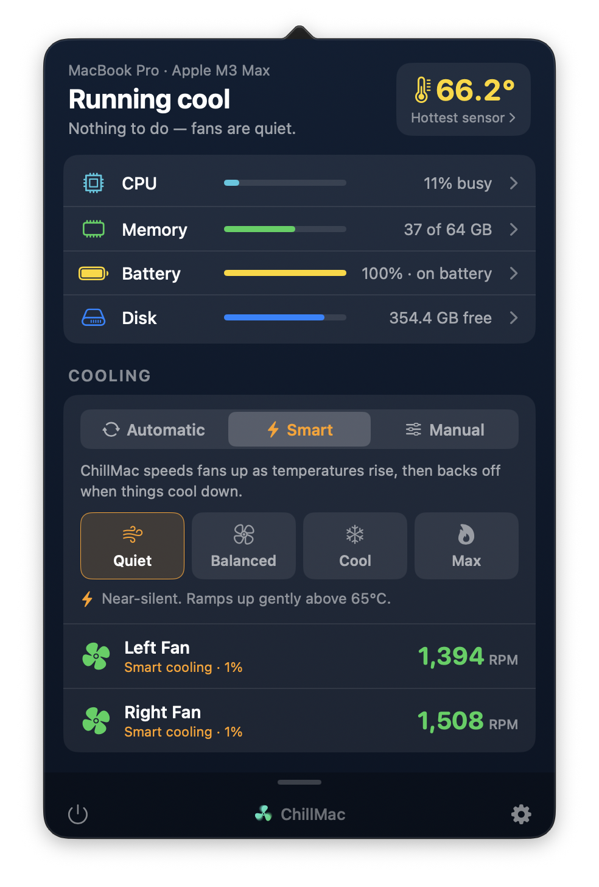
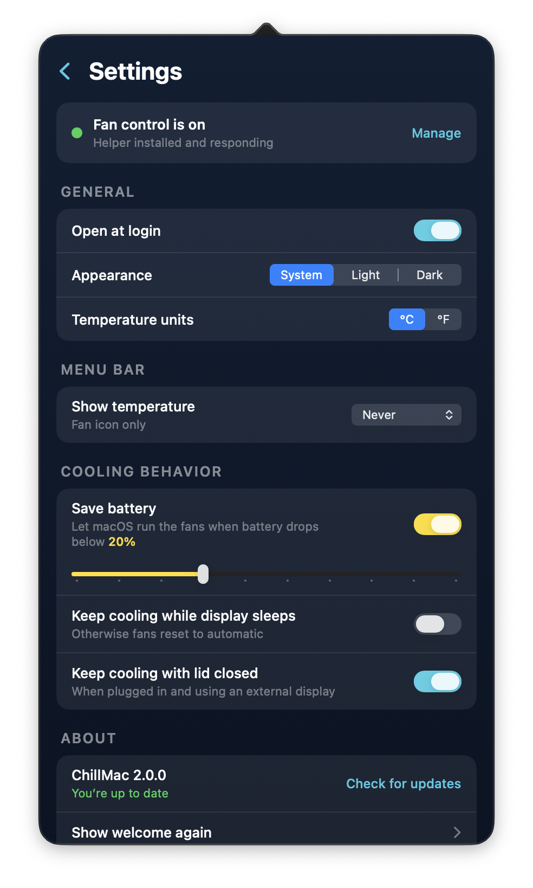
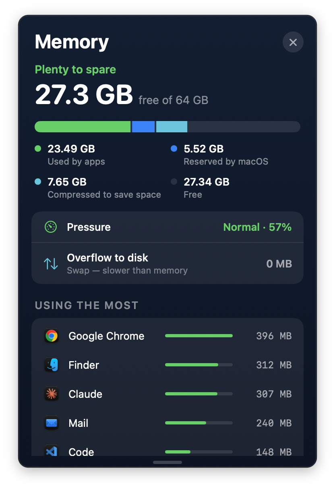
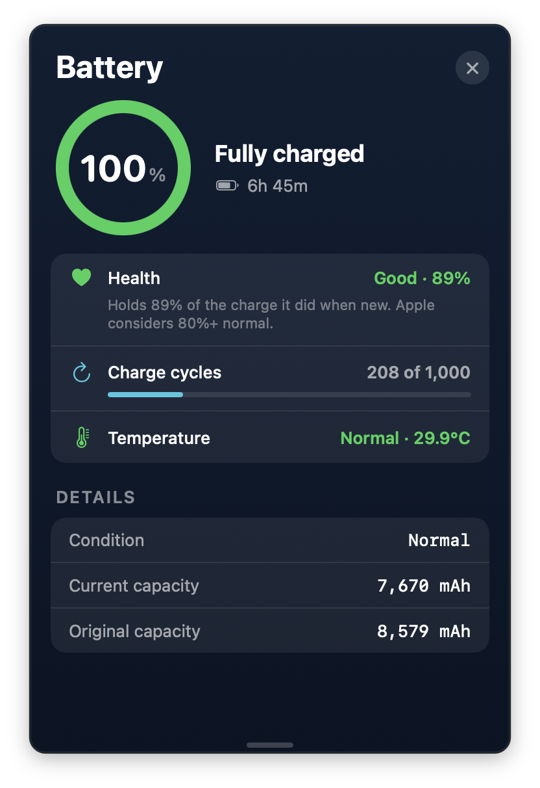
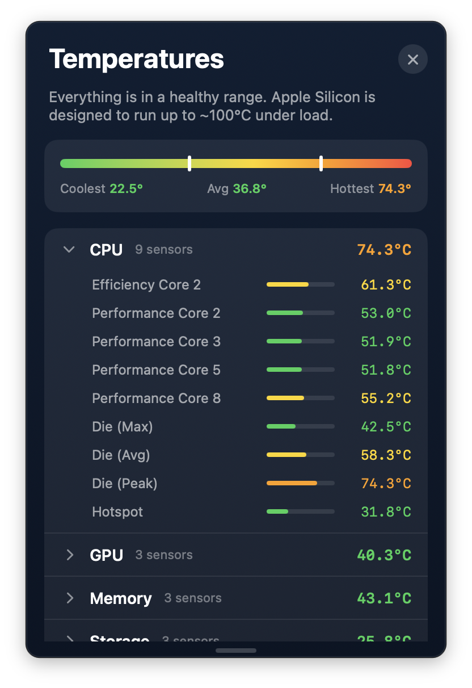

<p align="center">
  
</p>

# ChillMac

A free, open-source macOS menu bar app that tells you how your Mac is doing at a glance and lets you take control of its fans. Keep your Mac chilly.

**[Download ChillMac.dmg](https://github.com/idevtim/chillmac/releases/latest/download/ChillMac.dmg)** · [All releases](https://github.com/idevtim/chillmac/releases)

## Screenshots

<p align="center">
  
  
</p>

<p align="center">
  
  
  
</p>

## Features

- **At-a-glance status**: the popover opens with a plain-language summary ("Running cool", "Getting warm") and your hottest sensor, followed by one compact list of vitals
- **One Cooling control**: pick **Automatic** (macOS runs the fans), **Smart** (fans follow temperature, at Quiet, Balanced, Cool or Max intensity) or **Manual** (a fixed speed per fan)
- **Menu bar temperature**: show it never, only when your Mac is warm, or always
- **CPU**: live usage graph, top consuming apps, temperature, and uptime
- **Memory**: usage breakdown, pressure, swap, and top consumers
- **Battery**: charge, health, cycle count, and temperature
- **Disk**: storage by category (Apps, Documents, Downloads, Desktop, Other) with SSD temperature
- **Temperatures**: every detected sensor, grouped into CPU, GPU, Memory, Storage and Battery, color-coded from cool to hot
- **Guided setup**: a short welcome explains the fan control helper before asking for it. Monitoring works without it
- **Light and dark appearance**, following macOS or set by hand
- **Auto-update**: checks for new releases in the background, badges the menu bar icon, and installs in one click
- Apple Silicon (M1 to M5) and Intel Mac support

## Install

### Download (recommended)

1. [Download `ChillMac.dmg`](https://github.com/idevtim/chillmac/releases/latest/download/ChillMac.dmg) (always the latest release)
2. Open the DMG and drag ChillMac to Applications
3. Launch ChillMac. It appears in your menu bar and opens a short welcome
4. To control the fans, install the fan control helper from the welcome (or later from Settings), then allow ChillMac in **System Settings › General › Login Items & Extensions**

The DMG is signed, notarized, and stapled by Apple, so Gatekeeper lets it through.

### Homebrew

```sh
brew install --cask idevtim/tap/chillmac
```

Same signed build, from the tap. ChillMac updates itself through Sparkle afterwards, so
`brew upgrade` leaves it alone unless you pass `--greedy`. `brew uninstall --zap --cask chillmac`
stops the fan control helper and removes ChillMac's settings.

### Build from source

**Requirements:**
- macOS 13.0+
- Xcode 15+
- [XcodeGen](https://github.com/yonaskolb/XcodeGen) (`brew install xcodegen`)

```bash
git clone https://github.com/idevtim/chillmac.git
cd chillmac
xcodegen generate
xcodebuild -project ChillMac.xcodeproj -scheme ChillMac build
```

Or open `ChillMac.xcodeproj` in Xcode and hit Run.

> **Note:** Debug builds skip the helper's code signature check, so the privileged helper works without matching the original signing identity. You can build, run, and hack on ChillMac with your own (or no) Developer ID.

## How It Works

Two-process architecture with privilege separation:

```
Menu Bar App (UI + read-only SMC) ──XPC──> Helper Daemon (root, write SMC)
```

- **Main app** (unprivileged): reads SMC sensors every 2 seconds and shows the SwiftUI popover and detail panels.
- **Helper daemon** (root): installed via `SMAppService`, handles fan speed and mode writes over XPC. Both ends check each other's code signature before talking.

On M3 and M4 Macs, macOS's `thermalmonitord` holds the fans until the helper switches on SMC test mode, and then takes several seconds to let go. While that happens the Cooling card shows "Taking over the fans from macOS". The helper keeps test mode on for a minute after the fans go back to automatic, so reopening ChillMac or switching modes is instant. M1 and M5 Macs accept fan control without a handover. Signal handlers clean up if the helper exits unexpectedly, and fans always return to automatic when ChillMac quits.

## Contributing

Contributions are welcome! Fork the repo, make your changes, and open a PR.

```bash
# Fork and clone
git clone https://github.com/YOUR_USERNAME/chillmac.git
cd chillmac

# Set up
brew install xcodegen
xcodegen generate

# Build and run from Xcode, or:
xcodebuild -project ChillMac.xcodeproj -scheme ChillMac build
```

There's no test suite; testing is done manually via the UI. If you're adding a feature, just make sure the app builds and the feature works as expected.

## Project Structure

```
ChillMac/
  App/              Entry point, status bar controller, settings, update checker
  Views/            SwiftUI views (dashboard, fan controls, detail panels, settings)
  Fan/              Data models and monitoring engines (CPU, memory, battery, disk)
  SMC/              IOKit bridge to Apple SMC driver
  XPC/              Helper connection and installation
FanControlHelper/   Privileged helper daemon (runs as root)
Shared/             XPC protocol shared between app and helper
scripts/            Build and release tooling
```

## License

MIT, see [LICENSE](LICENSE) for details.
